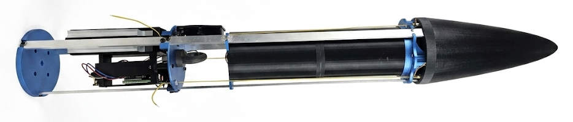
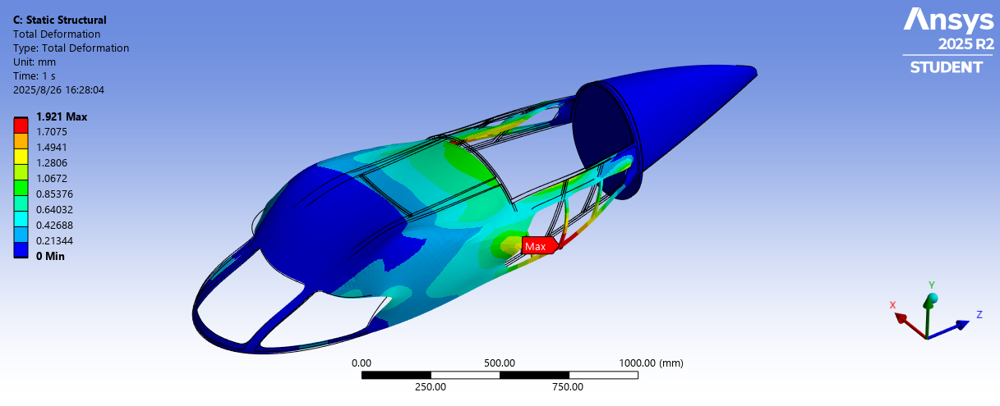

<section class="hero-section">
  
Imperial College London · MEng Mechanical Engineering (Sep 2023 – Jun 2027)

  <h1 class="hero-title">Stan (Shuo-Chun) Sun</h1>
  

    MEng Mechanical Engineering student (75.95% Year 3 standing, First Class Honours track) and former Product Design Engineer Intern at Google. Specializing in multibody dynamics (Siemens NX Motion), composite structural FEA (ANSYS ACP), precision CAD, and Python data workflows.
  

  

    📐 CAD (SolidWorks · Siemens NX · Fusion 360)
    ⚙️ Multibody Dynamics (NX Motion)
    📊 FEA (ANSYS Mechanical &amp; ACP · Abaqus · SolidWorks)
    🐍 Python &amp; MATLAB Data Processing
  

  

    <a class="btn-apple btn-primary" href="#experience">Experience Highlight</a>
    <a class="btn-apple btn-secondary" href="#projects">Explore Projects</a>
    <a class="btn-apple btn-secondary" href="./assets/cv/CV.Shuo-Chun%20Sun_2026.11.15_Public.pdf" target="_blank" rel="noopener">Download CV (PDF)</a>
    <a class="btn-apple btn-secondary" href="https://www.linkedin.com/in/shuo-chun-sun-43a850292" target="_blank" rel="noopener">LinkedIn</a>
    <a class="btn-apple btn-secondary" href="https://github.com/SJSUNJET" target="_blank" rel="noopener">GitHub</a>
    <a class="btn-apple btn-secondary" href="mailto:ss10323@ic.ac.uk">Email</a>
  

</section>

<section id="experience">
  

    <h2>Experience Highlight</h2>
    Industry Internship · Jun 2026 – Sep 2026
  

  

    

      

        
Google · Product Design Internship

        <h3 class="highlight-role">Product Design Engineer Intern</h3>
        
Google · Jun 2026 – Sep 2026

      

    

    

      

        
NX MBD

        
Dynamic torque modeling of spring-cam foldable hinge mechanisms in Siemens NX

      

      

        
&lt; 15%

        
Torque output deviation vs. experimental data across ±10% parameter shifts

      

      

        
Python

        
Noise-filtering simulation workflows &amp; standardised team simulation guide

      

    

    <ul class="highlight-bullets">
      <li>Simulated dynamic torque profiles for foldable smartphone hinges by constructing <strong>multibody dynamics (MBD) models</strong> for complex spring-cam mechanisms in <strong>Siemens NX</strong>.</li>
      <li>Formulated a <strong>dimensionless numerical sensitivity study</strong> to quantify torque output variance across <strong>±10% parameter shifts</strong>, achieving <strong>&lt;15% deviation</strong> against experimental torque data.</li>
      <li>Built data processing workflows with <strong>Python</strong> to filter signal noise and process simulation data, authoring a <strong>standardised simulation guide</strong> for the engineering team.</li>
    </ul>

    

      Siemens NX
      NX Motion (MBD)
      Spring-Cam Mechanisms
      Numerical Sensitivity Study
      Python (Data Processing)
      Simulation Standardization
    

  

</section>

<section id="projects">
  

    <h2>Featured Engineering Projects</h2>
    Click any card to view methodology, figures &amp; outcomes
  

  

    <!-- Card 1: ME3 DMT Rocket Recovery System -->
    <a class="project-card" href="./projects/me3-dmt.html">
      

        
        Aerospace &amp; Mechatronics
      

      

        
Rocket Parachute Recovery System · Sep 2025 – Jun 2026

        <h3 class="project-card-title">Two-Stage Electromechanical Rocket Recovery Module</h3>
        

          Co-led a 4-person team to design, manufacture, and qualify a dual-stage electromechanical parachute recovery module for a high-power rocket. Reduced bulkhead weight by 30% under 6 kN deployment shock loads via iterative FEA optimization, and designed shaker vibration experiments diagnosing an 1883 Hz resonance via Python.
        

        

          CAD &amp; Assembly BOM
          Static FEA Optimization
          Vibration Testing
          Python (Data Processing)
          Metal &amp; 3D-Printed Prototyping
        

      

    </a>

    <!-- Card 2: CFRP FEA -->
    <a class="project-card" href="./projects/CFRP-fea.html">
      

        
        Composite FEA
      

      

        
Imperial Eco-Marathon Team · Sep 2023 – Jun 2026

        <h3 class="project-card-title">Carbon-Fibre Monocoque &amp; Top Shell FEA Optimization</h3>
        

          Redesigned carbon-fibre composite structures for the Shell Global Competition vehicle using ANSYS Mechanical and ANSYS ACP, achieving a 40% monocoque mass reduction (8 kg) and reducing composite skin layup from 5 to 2 layers under multi-case loading conditions.
        

        

          ANSYS Mechanical &amp; ACP
          Static Structural
          40% Mass Reduction (8 kg)
          5 → 2 Layer CFRP Optimization
        

      

    </a>

    <!-- Card 3: Vibrational String Simulation -->
    <a class="project-card" href="./projects/vibration-sim.html">
      

        <video src="./assets/vibration-sim/explicit-solution.mp4#t=4,33" data-start="4" data-end="33" autoplay muted loop playsinline preload="auto"></video>
        Numerical PDE
      

      

        
Computational Mechanics · May 2025

        <h3 class="project-card-title">1D Wave Equation: Explicit vs. Crank–Nicolson Implicit Solver</h3>
        

          Implemented explicit central-difference and unconditionally stable Crank–Nicolson implicit finite-difference schemes in Python to analyze wave propagation, Dirichlet boundary reflections, and CFL stability limits.
        

        

          Python
          NumPy
          Matplotlib
          Finite Difference PDE
        

      

    </a>

  

</section>
