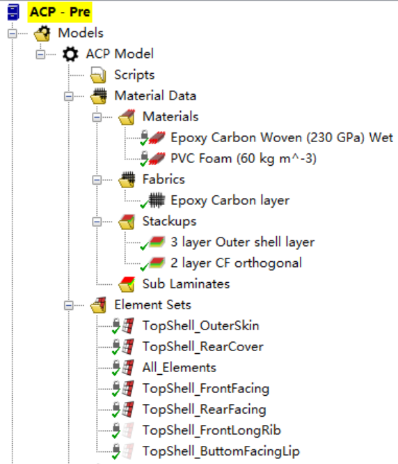
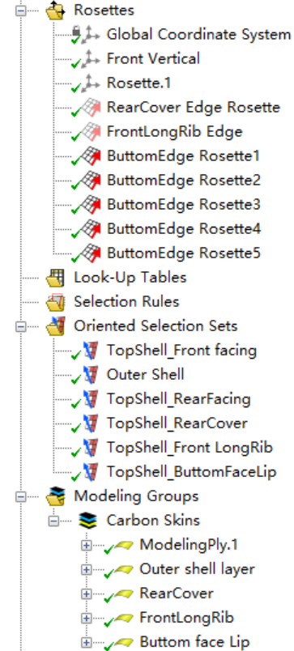
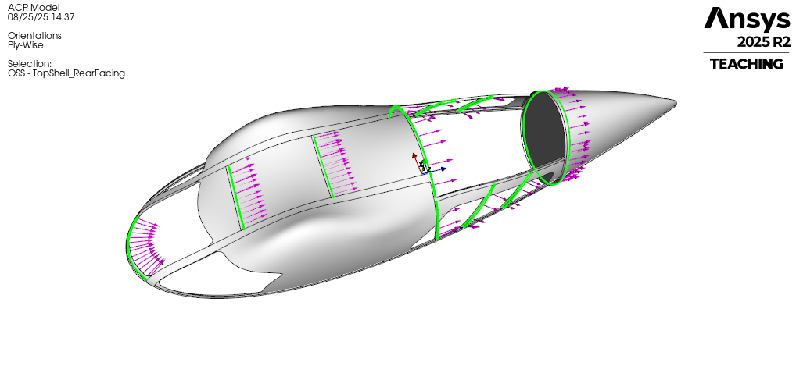
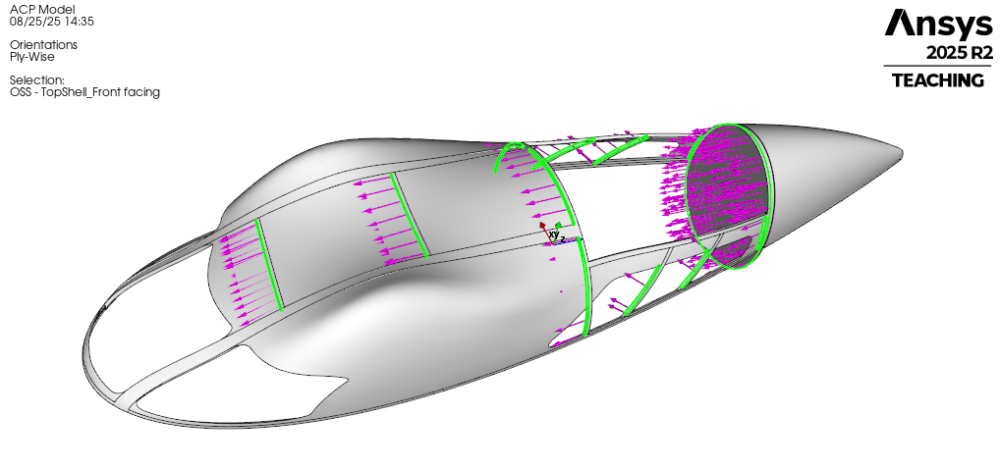
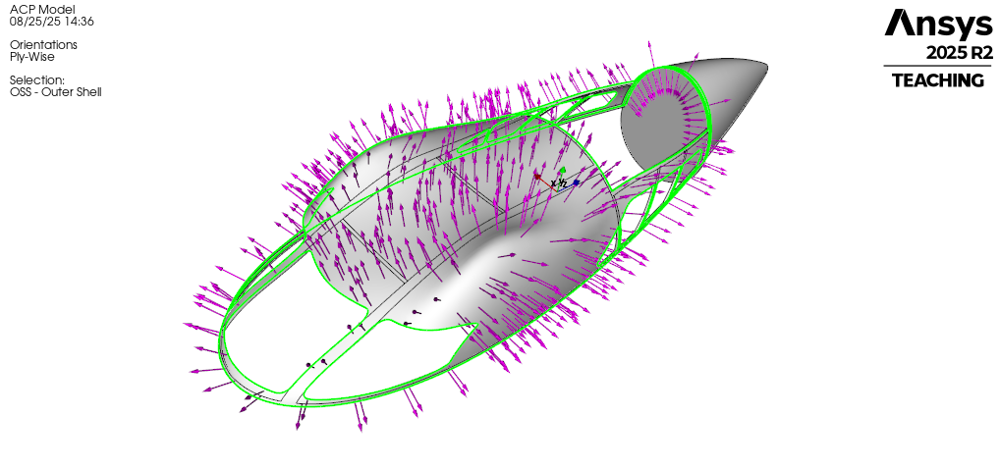
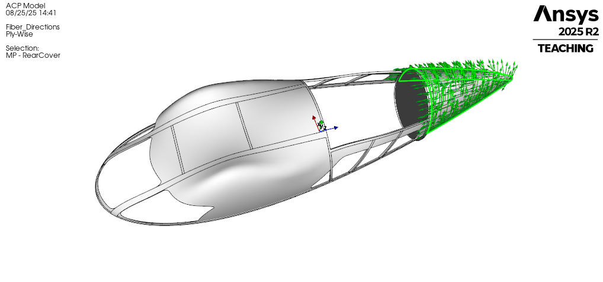
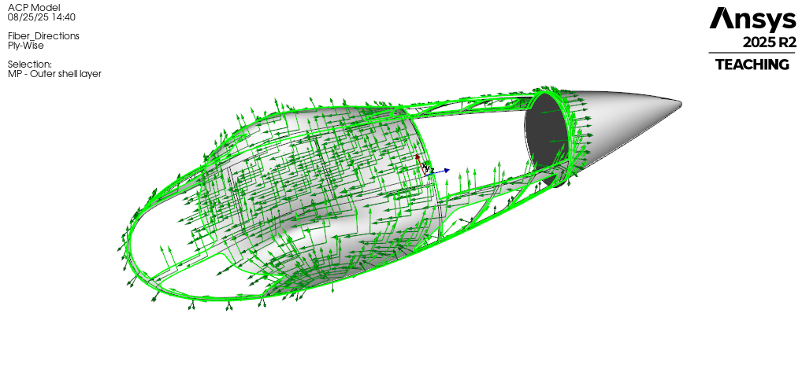
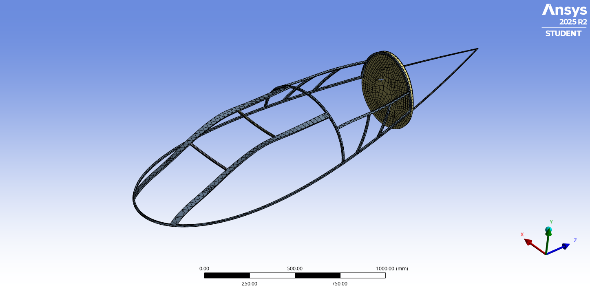
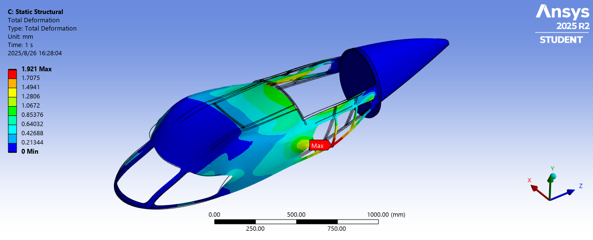
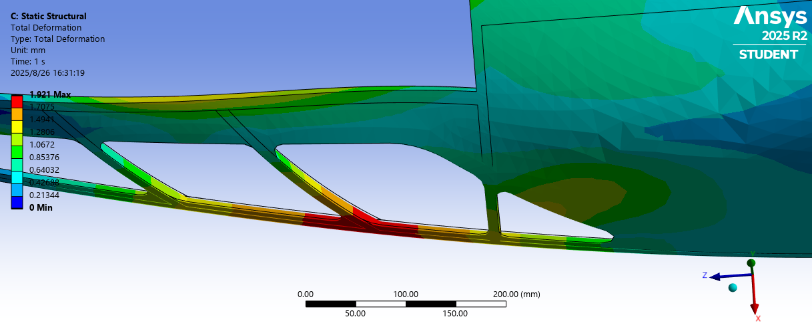

## 1. Project Overview & Objectives

Conducted a detailed finite element analysis (FEA) using **ANSYS Composite PrepPost — ACP (Pre)** and **ANSYS Static Structural** to evaluate the structural stiffness, load paths, and safety margin of the 3.0 Generation Imperial Eco-Marathon vehicle's carbon-fibre composite top shell.

During driver ingress and egress, the top-opening cockpit door periphery and longitudinal sill ribs experience concentrated downward loads. The primary objectives of this study were to:

- **Validate structural integrity** under localized loading representative of driver entry and exit.
- **Evaluate global and localized deformation** across the monocoque upper shell and internal stiffening ribs.
- **Identify stress/strain hotspots** along rib-to-skin junctions to guide targeted local ply reinforcement without adding unnecessary vehicle mass.

---

## 2. Composite Laminate Methodology in ANSYS ACP (Pre)

To accurately capture the orthotropic behaviour of the carbon-fibre reinforced polymer (CFRP) sandwich structure, the shell and rib laminates were built ply-by-ply inside **ANSYS ACP (Pre)** following a structured composite workflow:

1. **Engineering Material Definition:** Configured orthotropic **Epoxy Carbon Woven (230 GPa) Wet** prepreg/wet-layup skins paired with an isotropic **PVC Foam ($60\text{ kg/m}^3$)** structural sandwich core.
2. **Fabric & Stackup Creation:** Defined single-ply fabric thicknesses and assembled multi-layer stackups (`3-layer Outer Shell` laminate and `2-layer CF Orthogonal` rib reinforcements).
3. **Element Sets Partitioning:** Partitioned the shell geometry into functional structural zones (`TopShell_OuterSkin`, `TopShell_RearCover`, `TopShell_FrontFacing`, `TopShell_RearFacing`, `TopShell_FrontLongRib`, and `TopShell_BottomFacingLip`).
4. **Coordinate & Edge Rosettes:** Established global and edge-guided rosettes (`Front Vertical`, `RearCover Edge`, `FrontLongRib Edge`, and `BottomEdge Rosettes 1–5`) to control local $0^\circ$ fibre alignment along curved aerodynamic contours.
5. **Oriented Selection Sets (OSS) & Modeling Groups:** Assigned layup normal vectors and fibre reference directions to each element set before generating the 3D composite ply layup.

  <figure class="figure-card">
    
    <figcaption class="figure-caption">
      <strong>Figure 1a.</strong> ANSYS ACP (Pre) model tree illustrating Material Data (230 GPa woven carbon &amp; PVC foam), Stackups, and partitioned Element Sets.
    </figcaption>
  </figure>
  <figure class="figure-card">
    
    <figcaption class="figure-caption">
      <strong>Figure 1b.</strong> Rosette coordinate definitions, Oriented Selection Sets (OSS), and the resulting Carbon Skins Modeling Group hierarchy.
    </figcaption>
  </figure>

---

### Oriented Selection Sets (OSS) & Layup Normals

In ANSYS ACP (Pre), the **orientation direction** of an Oriented Selection Set dictates the stacking direction (offset normal) of successive carbon plies. Because internal transverse and longitudinal ribs feature opposing geometric normals, forward-facing and rear-facing rib surfaces were separated into dedicated OSS groups (`TopShell_RearFacing` and `TopShell_FrontFacing`) to guarantee consistent inward/outward laminate build directions.

  <figure class="figure-card">
    
    <figcaption class="figure-caption">
      <strong>Figure 2a.</strong> Ply-wise orientation vectors for the rear-facing rib selection set (<code>OSS - TopShell_RearFacing</code>).
    </figcaption>
  </figure>
  <figure class="figure-card">
    
    <figcaption class="figure-caption">
      <strong>Figure 2b.</strong> Opposing ply-wise orientation vectors for the front-facing rib selection set (<code>OSS - TopShell_FrontFacing</code>).
    </figcaption>
  </figure>

<figure class="figure-card">
  
  <figcaption class="figure-caption">
    <strong>Figure 3.</strong> Uniform outward ply stacking normal vectors defined across the primary aerodynamic outer shell skin (<code>OSS - Outer Shell</code>).
  </figcaption>
</figure>

---

### Fibre Alignment & Reference Directions ($0^\circ / 90^\circ$)

Within each Oriented Selection Set, the **reference direction** (governed by its linked Rosette) establishes the primary $0^\circ$ warp fibre trajectory and orthogonal $90^\circ$ weft direction. Edge rosettes were mapped along the cockpit sill and rear bulkhead perimeter so that primary carbon fibres run continuously along the principal bending and tension paths.

  <figure class="figure-card">
    
    <figcaption class="figure-caption">
      <strong>Figure 4a.</strong> Ply-wise fibre direction vectors aligned along the rear bulkhead and tail cone (<code>MP - RearCover</code>).
    </figcaption>
  </figure>
  <figure class="figure-card">
    
    <figcaption class="figure-caption">
      <strong>Figure 4b.</strong> Orthogonal $0^\circ$ and $90^\circ$ fibre alignment trajectories mapped across the outer shell skin and cockpit aperture frame (<code>MP - Outer shell layer</code>).
    </figcaption>
  </figure>

---

## 3. Solid Core Modelling & Adaptive Meshing

The structural stiffening ribs and rear bulkhead incorporate a lightweight **PVC foam core** enclosed by the carbon-fibre skins. In ANSYS Mechanical, the solid core geometry was discretized using **adaptive mesh sizing**—maintaining high element quality and aspect-ratio control around narrow rib intersections and cockpit cutout fillets while avoiding excessive element counts in uniform bulkhead zones.

<figure class="figure-card">
  
  <figcaption class="figure-caption">
    <strong>Figure 5.</strong> Adaptive finite element mesh of the internal PVC foam structural ribs, cockpit frame rails, and rear bulkhead disc.
  </figcaption>
</figure>

---

## 4. Static Structural Results & Hotspot Identification

The composite shell assembly was evaluated in **ANSYS Static Structural** under localized loading representative of driver entry and exit along the cockpit aperture rail:

- **Global Deformation Behaviour:** Total deformation remains well within structural clearance tolerances across the aerodynamic canopy, confirming that the sandwich rib architecture effectively resists cockpit frame racking and buckling.
- **Localized Hotspot Identification:** Detailed contour inspection along the lower cockpit sill cut-outs pinpointed the primary bending deflection and stress concentration zone at the central longitudinal rib junction, directly informing targeted local ply reinforcement.

  <figure class="figure-card">
    
    <figcaption class="figure-caption">
      <strong>Figure 6.</strong> Full-shell total deformation contour plot under localized cockpit sill loading, showing minimal deflection across the nose and tail sections and controlled compliance along the door aperture rail.
    </figcaption>
  </figure>
  <figure class="figure-card">
    
    <figcaption class="figure-caption">
      <strong>Figure 7.</strong> Close-up view of the critical rib-to-sill junction hotspot identified for targeted carbon-fibre patch reinforcement.
    </figcaption>
  </figure>

---

## 5. Validation & Engineering Impact

- **Weight & Stiffness Optimization:** Refining the composite ply schedule and concentrating reinforcement plies strictly at the identified cockpit sill hotspots enabled an estimated **~5% reduction in top-shell mass** while preserving full structural stiffness for driver ingress/egress.
- **Verification Workflow:** Combined mesh refinement checks at rib fillets with classical laminate theory sanity checks on the orthotropic carbon-epoxy stackup.

  <a class="btn-apple btn-secondary" href="../assets/CFRP-fea/FEA_Project%20Document.docx" download>
    📄 Download Original Project Document (.docx)
  </a>

