## 1. Executive Summary & Superproject Context

As part of the **ME3 Design, Make and Test (DMT)** curriculum at Imperial College London, our 4-person team designed, manufactured, and experimentally verified a **two-stage electromechanical parachute recovery system** for the DMT Rocket Superproject. 

The vehicle is a 4.04-metre-tall, 36.4 kg pressure-fed liquid bipropellant rocket (ethanol / nitrous oxide with a nitrogen pressurant system) engineered to generate 3000 N nominal thrust and compete at European Rocketry Challenge (**EuRoC**) standards.

<div class="figure-grid">
  <figure class="figure-card">
    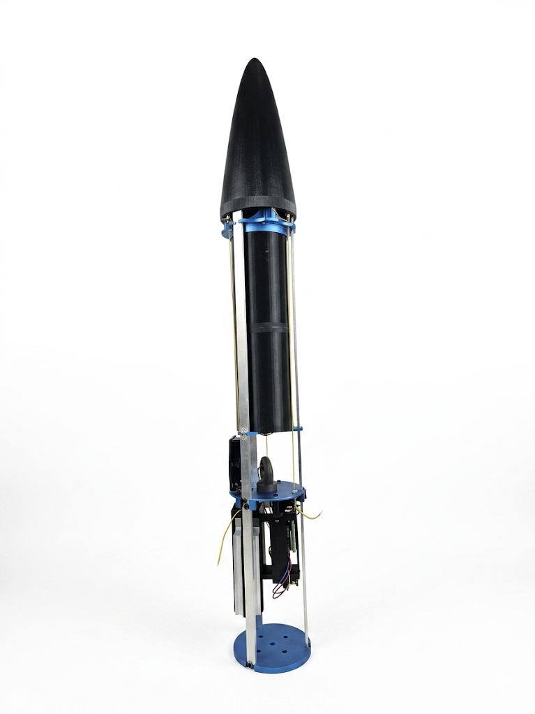
    <figcaption class="figure-caption">
      <strong>Figure 1.</strong> Full Superproject vehicle architecture: Subassembly A (Airframe &amp; Feed System), Subassembly B (Regeneratively Cooled Engine), and Subassembly C (Nose Cone Parachute Recovery).
    </figcaption>
  </figure>
  <figure class="figure-card">
    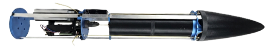
    <figcaption class="figure-caption">
      <strong>Figure 2.</strong> Fully manufactured and integrated Recovery System module featuring anodized 6061-T6 formers, 3D printed ABS nose cone, PLA parachute canister, and structural aluminum stringers.
    </figcaption>
  </figure>
</div>

### Personal Ownership & Technical Scope

Working in a close-knit, flat 4-person engineering team, my primary technical responsibilities encompassed:

1. **System & Mechanical Interface Leadership:** Co-led the recovery sub-team; defined physical envelope constraints, stringer pass-throughs, and structural loading boundaries with the Propulsion and Airframe sub-teams. Authored the master recovery assembly drawings (`DWG NO. C.AMB.002`) and nose cone assembly drawings (`DWG NO. C.AMB.001`).
2. **Bulkhead Structural Sizing & FEA Optimization:** Executed iterative structural finite element analyses in ANSYS, **applying the peak dynamic shock load (5.7 kN) as an equivalent static load input** to identify stress concentrations, evaluate rib load paths, and guide pocketing geometry. Achieved a **30% bulkhead weight reduction** while ensuring safety factor compliance ($SF_{\min} = 1.51$) well above the aerospace requirement ($SF \ge 1.5$). Evaluated transient dynamic response over time.
3. **Dynamic Vibration Campaign Planning & Telemetry Processing:** Formulated and led the dynamic shaker qualification campaign on Imperial’s **HADES (High Amplitude Dynamic Excitation System)** platform ($40\text{--}2000\text{ Hz}$ sine sweep and SMC-S-016 random vibration profile). Designed the test matrix, shaker adapter plate, and 4-channel accelerometer layout; collaborated with recovery teammates and the HADES facility technician for experimental execution. Authored the Python signal-processing pipeline (`scipy.signal`, `numpy`, `matplotlib`) to compute transmissibility functions ($H_{xy}$) and auto-PSDs ($G_{xx}$), diagnosing a critical cross-axis lateral resonance at $1883\text{ Hz}$.

---

## 2. Mechanical Architecture & Deployment Mechanics

The recovery system is housed entirely inside the forward airframe bay beneath the aerodynamic nose cone. To ensure personnel safety in the landing zone and preserve high-value on-board telemetry hardware, the system executes a **dual-stage deployment sequence**:

<div class="figure-grid">
  <figure class="figure-card">
    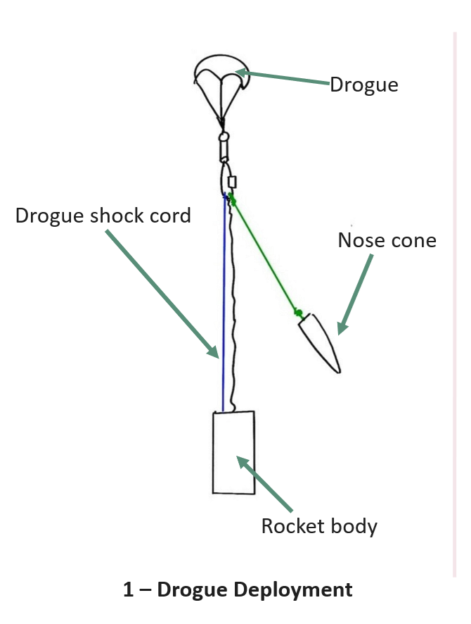
    <figcaption class="figure-caption">
      <strong>Stage 1 — Apogee Drogue Deployment:</strong> Nichrome burnwire cuts Dyneema retention cords; compression springs eject the nose cone, unfurling the 0.9 m Rocketman Pro Ex drogue to decelerate descent to $30.1\text{ m/s}$.
    </figcaption>
  </figure>
  <figure class="figure-card">
    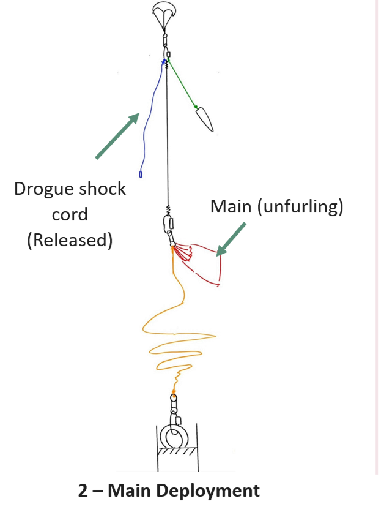
    <figcaption class="figure-caption">
      <strong>Stage 2 — Main Parachute Release (500 m AGL):</strong> Arduino/relay circuit unlocks the high-load rotary latch; the drogue pulls out the 2.4 m elliptical main canopy, slowing final descent to $8.1\text{ m/s}$ ($< 9\text{ m/s}$ EuRoC limit).
    </figcaption>
  </figure>
</div>

```
FLIGHT TRAJECTORY & RECOVERY SEQUENCE:
┌─────────────────┐       ┌────────────────────────┐       ┌───────────────────────┐
│ Apogee (2.5 km) │ ────> │ Drogue Ejection        │ ────> │ Main Release (500 m)  │ ────> Touchdown (< 9 m/s)
│ Flight Computer │       │ Nichrome wire melts    │       │ Rotary latch unlocks  │       Safe recovery of
│ triggers Relay  │       │ Dyneema cords; 200 N   │       │ drogue cord; pulls    │       vehicle body &
└─────────────────┘       │ springs push nose cone │       │ out 2.4 m main chute  │       payload electronics
                          └────────────────────────┘       └───────────────────────┘
```

<figure class="figure-card">
  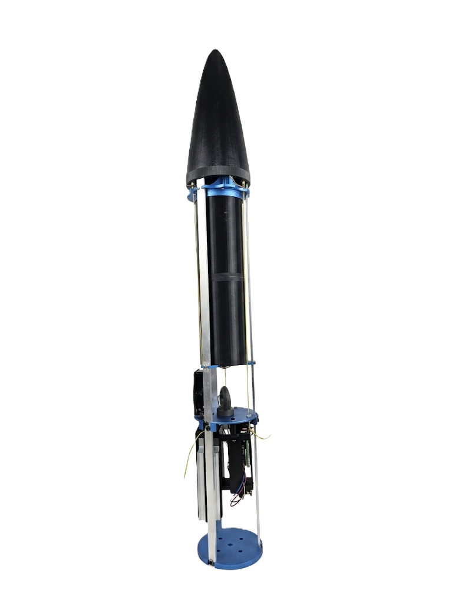
  <figcaption class="figure-caption">
    <strong>Figure 3.</strong> Subassembly internal layout: structural former plates, 3D printed parachute containment cylinder, Arduino/relay electronics housing, central M20 eyebolt, electronic rotary latch, and Dyneema tensioning cords.
  </figcaption>
</figure>

---

## 3. Bulkhead Structural Optimization: Static FEA Sizing & Dynamic Response

During main parachute deployment, vehicle deceleration induces sudden dynamic shock loads. Based on aerodynamic drag and shock factor calculations using William P. Ludtke parachute opening data:

$$\text{Peak Dynamic Shock Load} = 5.7\text{ kN}, \quad \text{Sustained Descent Load} = 3.9\text{ kN}$$

All deployment shock loads transfer through a heavy-duty **M20 central eye-bolt** anchored directly into the primary **6061-T6 aluminum bulkhead plate**, which distributes axial and bending forces outward into the vehicle's three longitudinal stringers.

<div class="figure-grid">
  <figure class="figure-card">
    <video width="100%" autoplay muted loop playsinline controls preload="metadata">
      <source src="../assets/me3-dmt/fea-bulkhead-transient-structural.mp4" type="video/mp4">
      Your browser does not support the video tag.
    </video>
    <figcaption class="figure-caption">
      <strong>Transient Structural Safety Factor Animation (ANSYS):</strong> Dynamic safety factor distribution across the optimized 6061-T6 bulkhead plate subjected to the 5.7 kN peak opening shock load over time, verifying absence of transient plastic yield.
    </figcaption>
  </figure>
  <figure class="figure-card">
    
    <figcaption class="figure-caption">
      <strong>Outsourced Precision CNC Hardware (JLC CNC):</strong> Anodized 6061-T6 bulkhead plate (left), parachute cylinder former (middle), and nose cone interface former (right) featuring the pocketed geometry that achieved a <strong>30% mass reduction</strong>.
    </figcaption>
  </figure>
</div>

### Finite Element Analysis & Sizing Highlights

1. **Static Structural Sizing & Mass Optimization:**
   - **Methodology:** Component sizing was conducted via iterative **Static Structural FEA in ANSYS**, applying the peak dynamic shock load (**$5.7\text{ kN}$**) as a conservative equivalent static load input applied axially through the central M20 eyebolt boss.
   - **Iterative Pocketing:** By analyzing von Mises stress contours and transverse bending moments, material was systematically pocketed out of low-stress interior zones while retaining stiffening ribs along direct radial load paths connecting the eyebolt boss to the stringer attachment lugs.
   - **Mass Reduction:** Replaced a monolithic former blank with the pocketed geometry, achieving a **30% mass reduction** without sacrificing plate stiffness.
   - **Safety Factor Compliance:** Localized peak stress at the eyebolt boss and stringer notch roots maintained an allowable safety factor well above unity (**$SF_{\min} = 1.51$** at peak shock, rising to $SF > 7.0$ steady state descent, complying with the aerospace requirement $SF \ge 1.5$).

2. **Transient Dynamic Verification:**
   - In addition to static sizing, a **Transient Structural simulation** (shown in the animation above) was conducted across the deceleration shock pulse to examine dynamic stress wave transmission, ensure absence of plastic deformation, and verify time-domain safety factor margins.

3. **Rotary Latch Mechanism Safety Margin:**
   - The electronic rotary latch mechanism was evaluated under drogue shock loads ($0.6\text{ kN}$ shock vs. $5.8\text{ kN}$ ultimate failure load $\rightarrow SF = 9.7$; $0.5\text{ kN}$ sustained vs. $0.8\text{ kN}$ rated release capacity $\rightarrow SF = 1.6$).

---

## 4. Manufacturing & Iterative Prototyping

To balance budget (£1,500 limit), precision tolerances, and turnaround times, manufacturing combined in-house machining at Imperial’s Student Workshop (STW) with precision outsourced CNC milling:

<div class="figure-grid">
  <figure class="figure-card">
    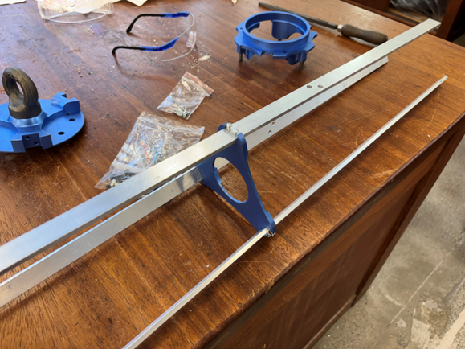
    <figcaption class="figure-caption">
      <strong>In-House STW Machining:</strong> Full-length 6061 aluminum stringers (milled using custom alignment jigs), former ring integration, and M20 eye-bolt bulkhead assembly on the STW workbench.
    </figcaption>
  </figure>
  <figure class="figure-card">
    
    <figcaption class="figure-caption">
      <strong>Nose Cone Spring Retention &amp; Safety Mechanism:</strong> Physical interface showing compressed 200 N alloy steel springs, M4 feed screw safety mechanical stops, capstan screws, and yellow Dyneema tensioning cords.
    </figcaption>
  </figure>
</div>

### Design Iteration: Nose Cone Tensioning Mechanism

During initial physical integration, a **braided 3-cord Dyneema** restraint configuration was tested to hold the nose cone firmly against the three compression springs ($200\text{ N}$ combined preload, $8.5\text{ mm}$ compression). 

**The Challenge:** Braiding introduced unexpected compliance, allowing the cords to stretch under tension and causing nose cone cocking and insufficient spring retention.

**The Solution:** We redesigned the restraint architecture to use **three independent Dyneema lines**, each anchored by a hollow tensioning bolt and lock-nut assembly directly at the bulkhead. This allowed precise individual tension tuning, eliminated slack, and ensured uniform spring precompression.

<figure class="figure-card" style="max-width: 600px; margin: 1.5rem auto;">
  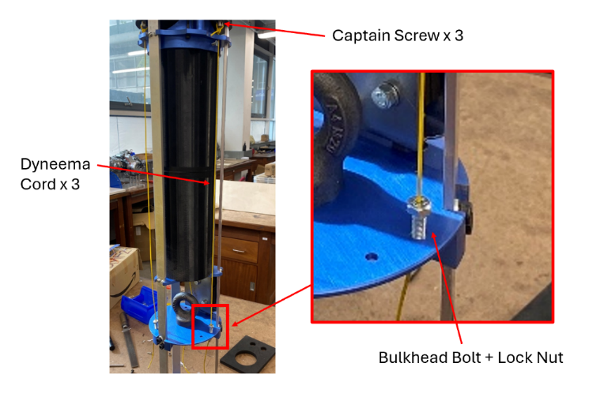
  <figcaption class="figure-caption">
    <strong>Figure 4.</strong> Redesigned independent tensioning mechanism: three individual Dyneema lines passing through threaded hollow bulkhead bolts with lock-nuts for fine pre-tensioning against the 200 N spring force.
  </figcaption>
</figure>

---

## 5. Experimental Testing & Telemetry Analysis

### Test A: Electromechanical Burnwire Sub-Test

The initial stage deployment relies on cutting the tensioned Dyneema cords via electrical resistance heating. A **35 SWG nichrome wire** ($0.203\text{ mm}$ OD, $30.31\ \Omega/\text{m}$) was coiled around each cord and actuated via an Arduino-triggered relay circuit ($18\text{ V}$, $2.97\text{ A}$ nominal current).

- **Cutting Reliability:** A single cord severed consistently in **$4.61 \pm 0.71\text{ s}$** at an adjusted resistive length of $13\text{ cm}$.
- **Thermal Integrity:** Tested without cord up to a $15\text{ s}$ continuous burn; confirmed the heating element operated far below its $1150^\circ\text{C}$ melting point without burnwire failure.

<div class="figure-grid">
  <figure class="figure-card">
    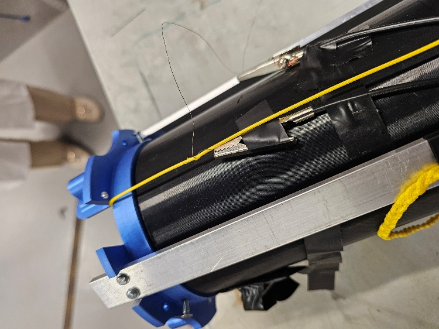
    <figcaption class="figure-caption">
      <strong>Burnwire Rig:</strong> 35 SWG nichrome wire coiled around the Dyneema cord and wired through safety relay channels.
    </figcaption>
  </figure>
  <figure class="figure-card">
    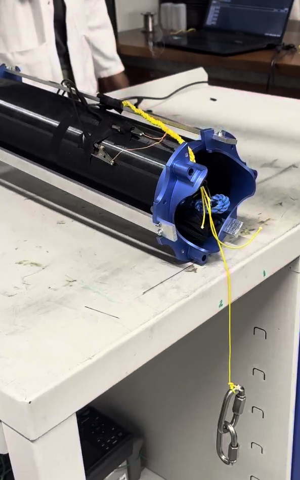
    <figcaption class="figure-caption">
      <strong>Active Severance:</strong> Verification run demonstrating rapid Dyneema melting and instantaneous nose cone release under 200 N spring preload.
    </figcaption>
  </figure>
</div>

---

### Test B: Rotary Latch Bench Release & CAGB 104 Wind Tunnel

To validate the second-stage main parachute extraction, we conducted both bench release trials and scaled wind tunnel testing in the Imperial Mechanical Engineering wind tunnel (CAGB 104):

- **Bench Actuation:** Confirmed that the motorized rotary latch disengages instantly on relay trigger, releasing the main shock cord loop under simulated Kevlar tension.
- **Wind Tunnel Deployment:** Modified the tunnel cross-section to $120 \times 80\text{ cm}$ to fly the 0.9 m drogue canopy. Verified that even at $5.48\text{ m/s}$ (approximately **$5.7\times$ lower dynamic pressure** than actual flight), the drogue generates sufficient aerodynamic pull to cleanly extract the main chute from the deployment canister without cord tangling.

<div class="figure-grid">
  <figure class="figure-card">
    <video width="100%" autoplay muted loop playsinline controls preload="metadata">
      <source src="../assets/me3-dmt/test-rotary-latch-release.mp4" type="video/mp4">
      Your browser does not support the video tag.
    </video>
    <figcaption class="figure-caption">
      <strong>Benchtop Release Test:</strong> Electronic rotary latch trigger releasing the Kevlar shock cord under tension on 3-2-1 countdown.
    </figcaption>
  </figure>
  <figure class="figure-card">
    <video width="100%" autoplay muted loop playsinline controls preload="metadata">
      <source src="../assets/me3-dmt/test-windtunnel-deployment.mp4" type="video/mp4">
      Your browser does not support the video tag.
    </video>
    <figcaption class="figure-caption">
      <strong>Wind Tunnel Deployment Test (CAGB 104):</strong> Two-stage extraction showing the drogue canopy pulling the main parachute out of the airframe canister upon latch actuation.
    </figcaption>
  </figure>
</div>

---

### Test C: Dynamic Shaker Vibration Testing (HADES Platform)

During launch and ascent, the recovery bay undergoes severe broadband random excitation from the 3000 N liquid bipropellant engine and transonic boundary layer buffet. To ensure mechanical integrity and verify that premature nose cone separation would not occur, I designed and planned the dynamic vibration qualification campaign on Imperial's **HADES (High Amplitude Dynamic Excitation System)** shaker platform.

**Campaign Planning & Setup:**
- Formulated the test envelope combining a **$6\text{g}$ axial sine sweep ($40\text{--}2000\text{ Hz}$)** and an **SMC-S-016 space qualification random vibration profile ($6.81\text{ Grms}$)**.
- Designed the mounting adapter fixture to rigidly bolt the recovery bay to the HADES shaker head.
- Defined the 4-channel accelerometer instrumentation matrix to capture control input, structural response, and cross-axis dynamics.
- **Collaborative Execution:** Physical rig mounting, shaker calibration, amplifier operation, and high-level safety procedures were executed in close collaboration with recovery teammates and the HADES facility laboratory technician.

<div class="figure-grid">
  <figure class="figure-card">
    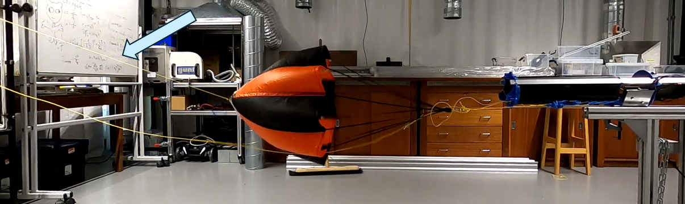
    <figcaption class="figure-caption">
      <strong>Instrumentation Setup:</strong> Triaxial and uniaxial accelerometers mounted at key measurement points: Ch 1 (Shaker vertical control), Ch 2 (Nose cone vertical), Ch 3 (Nose cone lateral), and Ch 4 (Payload lateral).
    </figcaption>
  </figure>
  <figure class="figure-card">
    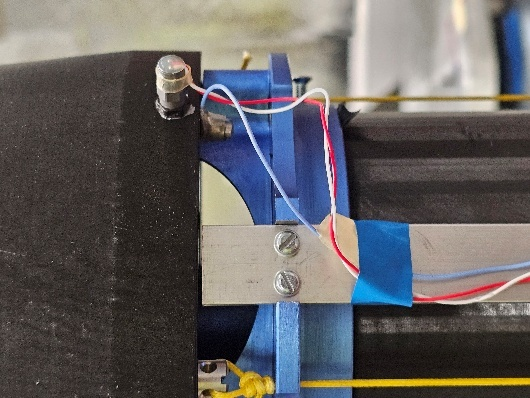
    <figcaption class="figure-caption">
      <strong>Physical Shaker Assembly:</strong> Recovery module bolted to HADES via a custom adapter bulkhead for vertical dynamic excitation ($40\text{--}2000\text{ Hz}$).
    </figcaption>
  </figure>
</div>

### Python Telemetry Processing & Critical Findings

I authored custom data analysis workflows in Python (`pandas`, `numpy`, `scipy`, `matplotlib`) to process raw Data Physics shaker telemetry, computing frequency response functions ($H_{xy}$), auto-spectra ($S_x$), and Power Spectral Densities ($G_{xx}$):

1. **Sine-Sweep Transmissibility (6g Axial Input, 40–2000 Hz):**
   - The payload exhibited low dynamic amplification ($1.17\text{ g/g}$ peak at $1265\text{ Hz}$), confirming the internal electronics bracket isolation.
   - However, at **$1883\text{ Hz}$**, the nose cone experienced extreme lateral amplification: **$90.87\text{ g/g}$ peak transmissibility**.
2. **Random Vibration (SMC-S-016 Space Standard):**
   - The shaker delivered a controlled vertical input of $6.81\text{ Grms}$ (compliant with the $6.90\text{ Grms} \pm 1.0\text{ dB}$ standard for units $< 22.7\text{ kg}$).
   - While all primary fasteners, stringers, and formers held without yielding, the lateral accelerometer recorded an amplified response of **$68.39\text{ Grms}$**.

<div class="figure-grid">
  <figure class="figure-card">
    
    <figcaption class="figure-caption">
      <strong>Sine-Sweep Transmissibility ($H_{xy}$):</strong> Processed telemetry revealing severe cross-axis lateral resonance of the nose cone ($90.87\text{ g/g}$ at $1883\text{ Hz}$) while the payload remained damped ($1.17\text{ g/g}$).
    </figcaption>
  </figure>
  <figure class="figure-card">
    
    <figcaption class="figure-caption">
      <strong>Random Vibration Power Spectral Density ($G_{xx}$):</strong> Comparison of shaker input control profile against the nose cone and payload response under simulated flight vibrations.
    </figcaption>
  </figure>
</div>

### Root-Cause Diagnosis & Engineering Recommendations

By cross-referencing high-speed test recordings with the $1883\text{ Hz}$ resonance peak, we discovered that **vertical shaker excitation converted into violent lateral string whipping**. The tensioned Dyneema lines possessed high axial tensile stiffness but minimal lateral bending stiffness, creating a strong cross-axis dynamic coupling.

This finding identified two critical flight risks:
- Aerodynamic boundary-layer disruption if the nose cone tilts off-axis during ascent.
- High-frequency cord chafing against bulkhead routing holes, which could cause premature Dyneema line failure and uncommanded nose cone deployment before apogee.

**Design Countermeasure:** For the next flight iteration, we specified a redesigned **nose cone interface former with an extended axial sleeve and tighter bilateral tolerances**, creating a mechanical hard-stop that physically constrains lateral displacement under launch vibration.

---

## 6. Key Deliverables & Engineering Drawings

To validate design intent, define manufacturing boundaries, and ensure flawless assembly tolerances, detailed manufacturing drawings were authored to BS 8888 standards.

### Primary Featured Assembly Drawing (DWG NO. C.AMB.002)

Authored by **Shuo-Chun Sun**, this complete 2-sheet A3 engineering package details the overall mechanical architecture, longitudinal sections, detailed rotary latch bracket arrangements, and the full 25-item Bill of Materials (BOM):

<div class="pdf-viewer-card" style="background: var(--bg-card, var(--bg-canvas)); border: 1px solid var(--border-hairline); border-radius: 16px; padding: 1.25rem; margin: 1.25rem 0 2rem;">
  <div style="display: flex; justify-content: space-between; align-items: center; margin-bottom: 0.85rem; flex-wrap: wrap; gap: 0.75rem;">
    <div>
      <span class="drawing-badge-author" style="margin-right: 0.5rem;">Drawn by Shuo-Chun Sun</span>
      <span class="drawing-number">DWG NO. C.AMB.002</span>
      <h4 style="margin: 0.35rem 0 0.15rem; font-size: 1.12rem; font-weight: 650; color: var(--text-primary);">Recovery System Assembly &amp; Complete Parts List</h4>
      <p style="margin: 0; font-size: 0.84rem; color: var(--text-secondary);">
        Sheet 1: Assembly Views &amp; Section B-B · Sheet 2: 25-Item BOM (Bulkhead, Stringers, Rotary Latch, Eye Bolt M20, Parachutes, Payloads)
      </p>
    </div>
    <a class="btn-apple btn-primary" href="../assets/me3-dmt/C.RECOVERY%20SYSTEM%20ASSEMBLY%20Drawing.pdf" target="_blank" rel="noopener">
      Open Full Vector PDF ↗
    </a>
  </div>
  <object data="../assets/me3-dmt/C.RECOVERY%20SYSTEM%20ASSEMBLY%20Drawing.pdf" type="application/pdf" width="100%" height="540px" style="border-radius: 10px; border: 1px solid var(--border-hairline); display: block; background: #ffffff;">
    <div style="padding: 2rem; text-align: center; color: var(--text-secondary);">
      <p>Inline PDF preview is available in desktop browsers.</p>
      <a class="btn-apple btn-primary" href="../assets/me3-dmt/C.RECOVERY%20SYSTEM%20ASSEMBLY%20Drawing.pdf" target="_blank" rel="noopener">
        View C.AMB.002 Drawing (PDF)
      </a>
    </div>
  </object>
</div>

### Representative Subassembly & Production Drawings

<div class="drawing-grid">

  <!-- Bulkhead Drawing -->
  <div class="drawing-card">
    <div>
      <div class="drawing-card-header">
        <span class="drawing-number">DWG NO. C.310</span>
        <span class="drawing-spec-pill">Scale 1:3 · A4</span>
      </div>
      <h3 class="drawing-title">Bulkhead CNC Production Drawing</h3>
      <p class="drawing-desc">
        Manufacturing drawing for the primary load-bearing 6061-T6 plate. Details the 30% mass-reduction pocketing, central M20x2.5 eyebolt thread, stringer cutouts, and coordinate table for all 7 precision mounting holes.
      </p>
      <div class="drawing-specs">
        <span class="drawing-spec-pill">Aluminium 6061-T6</span>
        <span class="drawing-spec-pill">Ra 3.2 Machined Faces</span>
        <span class="drawing-spec-pill">Tolerances ±0.02 mm</span>
      </div>
    </div>
    <a class="btn-apple btn-secondary" href="../assets/me3-dmt/Bulkhead%20Drawing.pdf" target="_blank" rel="noopener" style="text-align: center; justify-content: center;">
      📐 View Bulkhead Drawing (PDF)
    </a>
  </div>

  <!-- Nose Cone Assembly Drawing -->
  <div class="drawing-card">
    <div>
      <div class="drawing-card-header">
        <span class="drawing-number">DWG NO. C.AMB.001</span>
        <span class="drawing-badge-author">Drawn by Shuo-Chun Sun</span>
      </div>
      <h3 class="drawing-title">Nose Cone Assembly Drawing</h3>
      <p class="drawing-desc">
        Full assembly drawing detailing the aerodynamic nose cone integration, 3-spring ejection arrangement (RS PRO 35.5x7.55 alloy steel springs), brass threaded inserts, and 9-part BOM.
      </p>
      <div class="drawing-specs">
        <span class="drawing-spec-pill">Scale 1:2 · A3</span>
        <span class="drawing-spec-pill">Section A-A (1:2)</span>
        <span class="drawing-spec-pill">9-Part BOM</span>
      </div>
    </div>
    <a class="btn-apple btn-secondary" href="../assets/me3-dmt/Nose%20Cone%20Assembly%20Drawing.pdf" target="_blank" rel="noopener" style="text-align: center; justify-content: center;">
      📐 View Nose Cone Drawing (PDF)
    </a>
  </div>

  <!-- Interface Ring Drawing -->
  <div class="drawing-card">
    <div>
      <div class="drawing-card-header">
        <span class="drawing-number">DWG NO. C.304</span>
        <span class="drawing-spec-pill">Scale 1:2 · A4</span>
      </div>
      <h3 class="drawing-title">Interface Ring Production Drawing</h3>
      <p class="drawing-desc">
        Precision CNC former ring providing the mechanical interface between the nose cone retention base, compression springs, and the longitudinal stringers with radial locking channels.
      </p>
      <div class="drawing-specs">
        <span class="drawing-spec-pill">Aluminium 6061</span>
        <span class="drawing-spec-pill">Hole Table A1–C3</span>
        <span class="drawing-spec-pill">Fillets R2 Max</span>
      </div>
    </div>
    <a class="btn-apple btn-secondary" href="../assets/me3-dmt/Interface%20Ring%20Drawing.pdf" target="_blank" rel="noopener" style="text-align: center; justify-content: center;">
      📐 View Interface Ring Drawing (PDF)
    </a>
  </div>

</div>

<div class="cta-row" style="margin-top: 1.5rem; justify-content: center;">
  <a class="btn-apple btn-primary" href="../assets/me3-dmt/C.RECOVERY%20SYSTEM%20ASSEMBLY%20Drawing.pdf" target="_blank" rel="noopener">
    📐 View Master Recovery Drawing (C.AMB.002)
  </a>
  <a class="btn-apple btn-secondary" href="../assets/me3-dmt/Bulkhead%20Drawing.pdf" target="_blank" rel="noopener">
    📐 View Bulkhead Drawing (C.310)
  </a>
  <a class="btn-apple btn-secondary" href="../assets/me3-dmt/hardware-assembly-full.png" target="_blank" rel="noopener">
    🔍 High-Res Hardware Assembly Photo
  </a>
</div>
