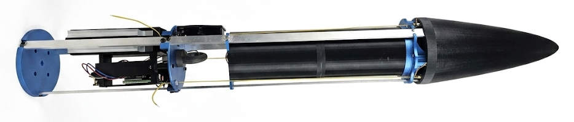
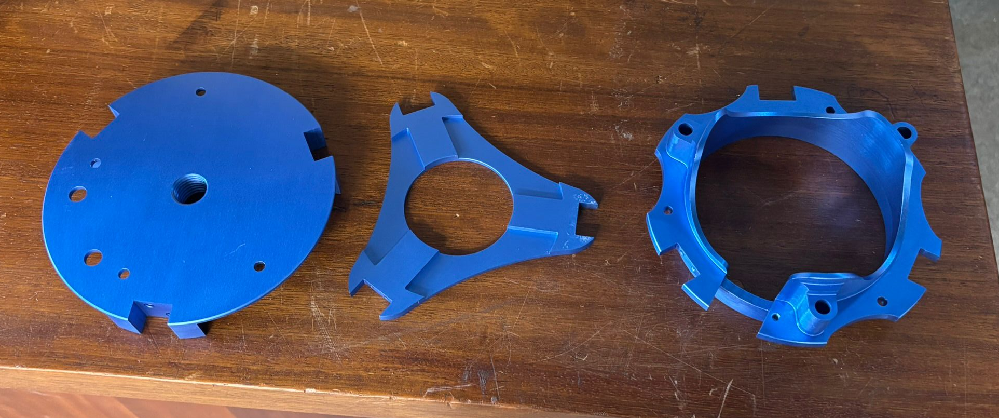
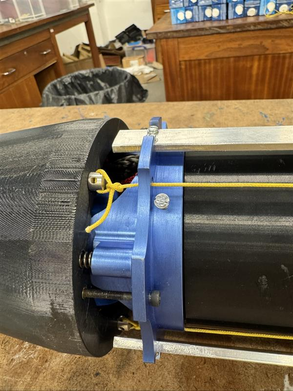
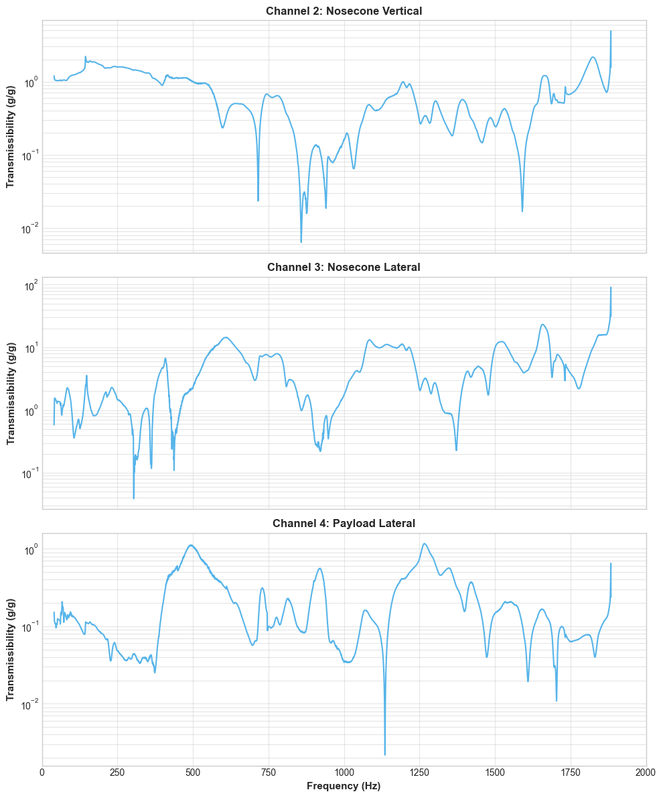
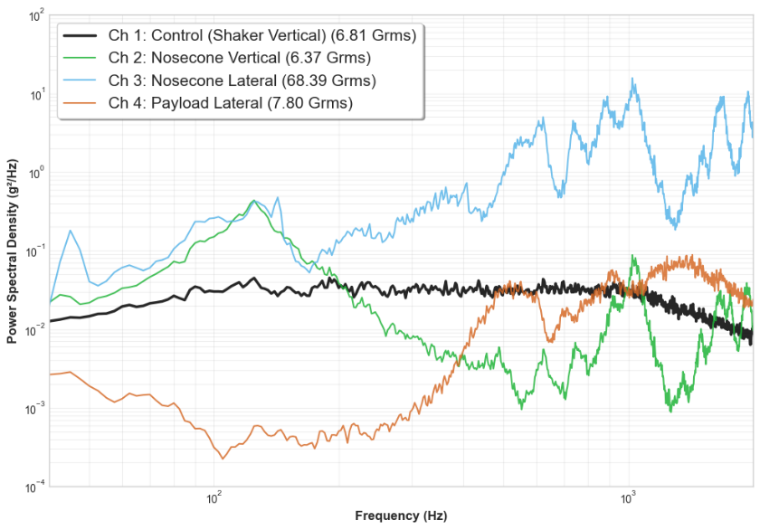
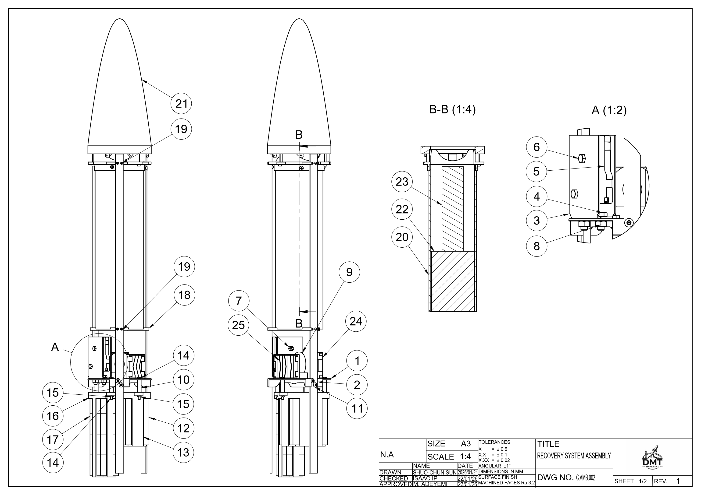
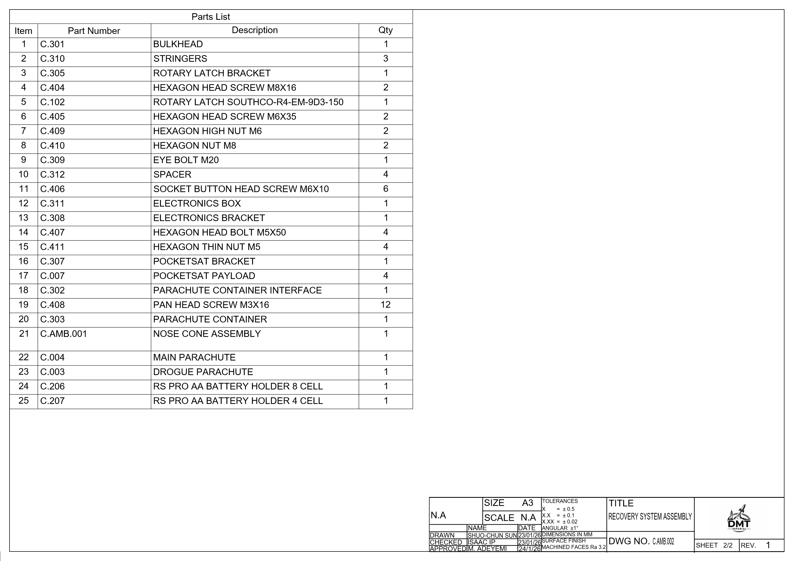
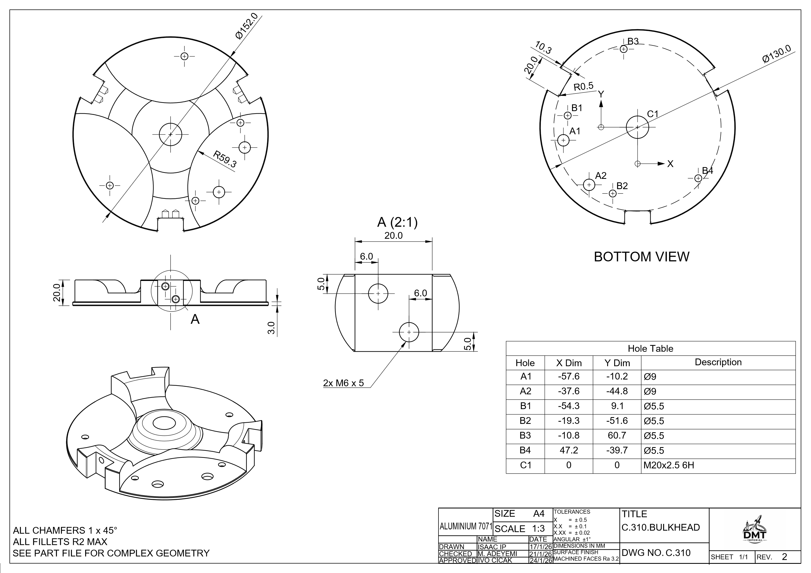
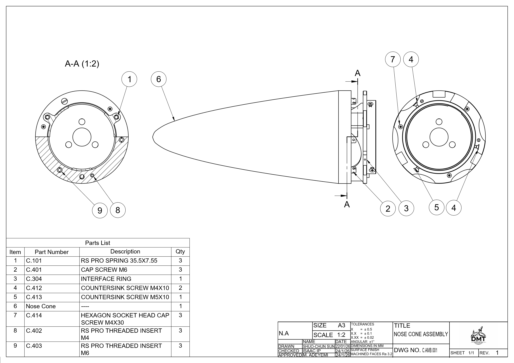
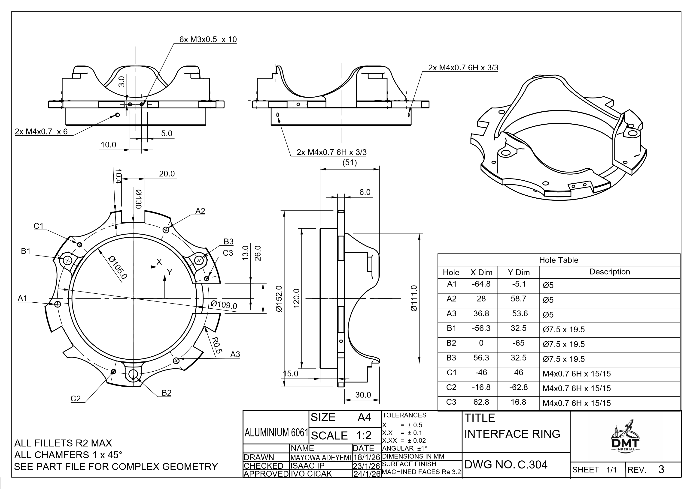

## 1. Executive Summary & Superproject Context

As part of the **ME3 Design, Make and Test (DMT)** curriculum at Imperial College London, our 4-person team designed, manufactured, and experimentally verified a **two-stage electromechanical parachute recovery module** intended for the DMT Rocket Superproject.

Designed to meet European Rocketry Challenge (**EuRoC**) descent specifications within a 4-metre multi-team competition vehicle architecture, our sub-team delivered and experimentally qualified the **standalone parachute recovery module** (full vehicle assembly across propulsion, airframe, and recovery sub-teams was not completed due to project time and resource constraints).

<figure class="figure-card">
  
  <figcaption class="figure-caption">
    <strong>Figure 1 — Superproject Vehicle Architecture:</strong> Intended 4 m vehicle layout dividing mechanical responsibilities across Team B (Nozzle, Cooling &amp; Injection Systems), Team A (Propellant Delivery &amp; Structural Framework), and Team C (Two-Stage Parachute Recovery &amp; Reusability).
  </figcaption>
</figure>

<figure class="figure-card">
  
  <figcaption class="figure-caption">
    <strong>Figure 2 — Manufactured Recovery Module (Subassembly C):</strong> Completed horizontal hardware featuring the 3D-printed ABS nose cone, anodized aluminum structural formers, machined stringers, PLA parachute containment canister, central M20 eyebolt bulkhead, and Arduino/relay electronics bay.
  </figcaption>
</figure>

### Personal Ownership & Technical Scope

Working in a close-knit, flat 4-person engineering team, my primary technical responsibilities encompassed:

1. **System & Mechanical Interface Leadership:** Co-led the recovery sub-team; defined physical envelope constraints, stringer pass-throughs, and structural loading boundaries with the Propulsion and Airframe sub-teams. Authored the master recovery assembly drawings (`DWG NO. C.AMB.002`) and nose cone assembly drawings (`DWG NO. C.AMB.001`).
2. **Bulkhead Structural Sizing & Static FEA Optimization:** Executed iterative static structural and shape-optimization FEA, **applying the peak dynamic shock load (5.7 kN) as an equivalent static load input** to identify stress concentrations, preserve primary rib load paths, and guide material pocketing. Achieved a **30% bulkhead weight reduction** while ensuring safety factor compliance ($SF_{\min} = 1.51$) well above aerospace requirements ($SF \ge 1.5$).
3. **Vibration Testing Campaign Planning & Python Data Processing:** Formulated and led the **planning** of the dynamic shaker table qualification campaign ($40\text{--}2000\text{ Hz}$ sine sweep and SMC-S-016 random vibration profile). Designed the test matrix, shaker adapter plate, and 4-channel accelerometer instrumentation layout; collaborated with recovery teammates and the laboratory technician for test execution. Authored Python data-processing pipelines (`scipy.signal`, `numpy`, `matplotlib`) to compute transmissibility functions ($H_{xy}$) and auto-PSDs ($G_{xx}$), diagnosing a critical cross-axis lateral resonance at $1883\text{ Hz}$.

---

## 2. Mechanical Architecture & Deployment Mechanics

The recovery module is housed inside the forward airframe section beneath the aerodynamic nose cone. To ensure range safety and preserve on-board electronics hardware, the module executes a **dual-stage electromechanical deployment sequence**:

  <figure class="figure-card">
    
    <figcaption class="figure-caption">
      <strong>Stage 1 — Apogee Drogue Deployment:</strong> Nichrome burnwire cuts Dyneema retention cords; compression springs eject the nose cone, unfurling the 0.9 m Rocketman Pro Ex drogue to decelerate descent to $30.1\text{ m/s}$.
    </figcaption>
  </figure>
  <figure class="figure-card">
    
    <figcaption class="figure-caption">
      <strong>Stage 2 — Main Parachute Release (500 m AGL):</strong> Arduino/relay circuit unlocks the high-load rotary latch; the drogue pulls out the 2.4 m elliptical main canopy, slowing final descent to $8.1\text{ m/s}$ ($< 9\text{ m/s}$ EuRoC limit).
    </figcaption>
  </figure>

---

## 3. Bulkhead Structural Optimization & Static FEA Sizing

During main parachute deployment, aerodynamic deceleration induces high axial opening shock loads. Based on aerodynamic drag and shock factor calculations using William P. Ludtke parachute opening data:

$$\text{Peak Dynamic Shock Load} = 5.7\text{ kN}, \quad \text{Sustained Descent Load} = 3.9\text{ kN}$$

All deployment shock loads transfer through a heavy-duty **M20 central eye-bolt** anchored directly into the primary **aluminum bulkhead plate**, which distributes axial and bending forces outward into the module's three longitudinal stringers.

  <figure class="figure-card">
    
    <figcaption class="figure-caption">
      <strong>Shape Optimization for Mass Reduction:</strong> FEA topology optimization identifying critical load paths from the central M20 eyebolt boss outward to the three stringer lugs and mounting bosses (0.159 kg optimized core mass).
    </figcaption>
  </figure>
  <figure class="figure-card">
    
    <figcaption class="figure-caption">
      <strong>Modified Pocketed Bulkhead CAD:</strong> Final machinable geometry incorporating stiffening spokes and filleted pockets in low-stress zones derived directly from the optimization results.
    </figcaption>
  </figure>

<figure class="figure-card">
  
  <figcaption class="figure-caption">
    <strong>Precision CNC-Machined Hardware:</strong> Anodized aluminum bulkhead plate (left), parachute cylinder former (middle), and nose cone interface former (right) featuring the pocketed geometry that achieved a <strong>30% mass reduction</strong>.
  </figcaption>
</figure>

### Static Structural Sizing & Safety Margins

1. **Static FEA Sizing & Mass Optimization:**
   - **Methodology:** Component sizing was performed via iterative **Static Structural FEA**, applying the maximum dynamic opening shock load (**$5.7\text{ kN}$**) as a conservative equivalent static load input axially through the central M20 eyebolt boss.
   - **Iterative Pocketing:** Using shape optimization and von Mises stress contours, low-stress material zones were systematically pocketed out while retaining structural spokes along direct radial bending load paths to the three stringers.
   - **Mass & Safety Compliance:** Achieved a **30% bulkhead weight reduction** over the initial solid disc while keeping localized peak stress at the eyebolt boss and stringer notch roots safely above unity (**$SF_{\min} = 1.51$** at peak shock, rising to $SF > 7.0$ under sustained descent).
2. **Rotary Latch Mechanism Safety Margin:**
   - The electronic rotary latch mechanism was evaluated under drogue shock loads ($0.6\text{ kN}$ shock vs. $5.8\text{ kN}$ ultimate failure load $\rightarrow SF = 9.7$; $0.5\text{ kN}$ sustained vs. $0.8\text{ kN}$ rated release capacity $\rightarrow SF = 1.6$).

---

## 4. Manufacturing & Iterative Prototyping

To balance budget (£1,500 limit), precision tolerances, and turnaround times, fabrication combined in-house metal machining and 3D-printed prototyping at Imperial’s Student Workshop (STW) with precision outsourced CNC milling:

  <figure class="figure-card">
    
    <figcaption class="figure-caption">
      <strong>In-House Metal &amp; Prototype Assembly:</strong> Full-length aluminum stringers (machined using custom alignment jigs), former ring integration, and M20 eye-bolt bulkhead assembly on the workshop bench.
    </figcaption>
  </figure>
  <figure class="figure-card">
    
    <figcaption class="figure-caption">
      <strong>Nose Cone Spring Retention &amp; Safety Mechanism:</strong> Physical interface showing compressed 200 N alloy steel springs, M4 feed screw safety mechanical stops, capstan screws, and Dyneema tensioning cords.
    </figcaption>
  </figure>

### Design Iteration: Nose Cone Tensioning Mechanism

During initial physical integration, a **braided 3-cord Dyneema** restraint configuration was tested to hold the nose cone firmly against the three compression springs ($200\text{ N}$ combined preload, $8.5\text{ mm}$ compression).

**The Challenge:** Braiding introduced unexpected compliance, allowing the cords to stretch under tension and causing nose cone cocking and insufficient spring retention.

**The Solution:** We redesigned the restraint architecture to use **three independent Dyneema lines**, each anchored by a hollow tensioning bolt and lock-nut assembly directly at the bulkhead. This allowed precise individual tension tuning, eliminated slack, and ensured uniform spring precompression.

<figure class="figure-card" style="max-width: 600px; margin: 1.5rem auto;">
  
  <figcaption class="figure-caption">
    <strong>Figure 3 — Redesigned Tensioning Mechanism:</strong> Three independent Dyneema lines passing through threaded hollow bulkhead bolts with lock-nuts for fine pre-tensioning against the 200 N spring force.
  </figcaption>
</figure>

---

## 5. Experimental Testing & Python Data Analysis

### Test A: Electromechanical Burnwire Sub-Test

Stage 1 deployment relies on severing tensioned Dyneema cords via electrical resistance heating. A **35 SWG nichrome wire** ($0.203\text{ mm}$ OD, $30.31\ \Omega/\text{m}$) was coiled around each cord and actuated via an Arduino-triggered relay circuit ($18\text{ V}$, $2.97\text{ A}$ nominal current).

- **Cutting Reliability:** A single cord severed consistently in **$4.61 \pm 0.71\text{ s}$** at an adjusted resistive length of $13\text{ cm}$.
- **Thermal Integrity:** Tested without cord up to a $15\text{ s}$ continuous burn; confirmed the heating element operated well below its $1150^\circ\text{C}$ melting point without burnwire failure.

<figure class="figure-card">
  <video width="100%" autoplay muted loop playsinline controls preload="metadata" src="../assets/me3-dmt/Burnwire%20test%20release%20footage.mov">
    Your browser does not support inline playback of this video.
  </video>
  <figcaption class="figure-caption">
    <strong>Burnwire Test Release Footage:</strong> Live electromechanical verification showing the Arduino-controlled 35 SWG nichrome burnwire rapidly melting through tensioned Dyneema restraint cords, releasing the spring-loaded nose cone.
  </figcaption>
</figure>

---

### Test B: Wind Tunnel Two-Stage Deployment (CAGB 104)

To validate Stage 2 main parachute extraction under airflow, we conducted scaled aerodynamic deployment testing in the Imperial Mechanical Engineering wind tunnel (CAGB 104):

- **Wind Tunnel Extraction:** Modified the tunnel cross-section to $120 \times 80\text{ cm}$ to fly the 0.9 m drogue canopy. Verified that even at $5.48\text{ m/s}$ (approximately **$5.7\times$ lower dynamic pressure** than target flight), triggering the electronic rotary latch enables the drogue to generate sufficient aerodynamic drag to cleanly extract the main chute from the deployment canister without cord tangling.

<figure class="figure-card">
  <video width="100%" autoplay muted loop playsinline controls preload="metadata">
    <source src="../assets/me3-dmt/test-windtunnel-deployment.mp4" type="video/mp4">
    Your browser does not support the video tag.
  </video>
  <figcaption class="figure-caption">
    <strong>Wind Tunnel Deployment Test (CAGB 104):</strong> Full two-stage extraction showing the drogue canopy pulling the main parachute out of the airframe canister upon rotary latch actuation.
  </figcaption>
</figure>

---

### Test C: Dynamic Vibration Testing

During ascent, forward airframe modules experience severe broadband random excitation. To evaluate structural resonance margins and ensure premature nose cone separation would not occur, I formulated and planned the dynamic vibration qualification campaign on Imperial's dynamic shaker table platform (**HADES**).

**Campaign Planning & Setup:**
- Formulated the test envelope combining a **$6\text{g}$ axial sine sweep ($40\text{--}2000\text{ Hz}$)** and an **SMC-S-016 space qualification random vibration profile ($6.81\text{ Grms}$)**.
- Designed the mounting adapter fixture to rigidly bolt the recovery bay to the shaker head.
- Defined the 4-channel accelerometer instrumentation matrix to capture control input, structural response, and cross-axis dynamics.
- **Collaborative Execution:** Physical rig mounting, shaker calibration, amplifier operation, and facility safety procedures were conducted collaboratively with my recovery teammates and the laboratory technician.

  <figure class="figure-card">
    
    <figcaption class="figure-caption">
      <strong>Instrumentation Setup:</strong> Triaxial and uniaxial accelerometers mounted at key measurement points: Ch 1 (Shaker vertical control), Ch 2 (Nose cone vertical), Ch 3 (Nose cone lateral), and Ch 4 (Payload lateral).
    </figcaption>
  </figure>
  <figure class="figure-card">
    <video width="100%" autoplay muted loop playsinline controls preload="metadata">
      <source src="../assets/me3-dmt/Vibration%20Test%20Footage.mp4" type="video/mp4">
      Your browser does not support the video tag.
    </video>
    <figcaption class="figure-caption">
      <strong>Vibration Test Footage:</strong> Recovery module bolted to the HADES shaker via a custom adapter bulkhead undergoing vertical dynamic excitation ($40\text{--}2000\text{ Hz}$).
    </figcaption>
  </figure>

### Python Data Processing & Critical Findings

I authored custom data analysis workflows in Python (`pandas`, `numpy`, `scipy`, `matplotlib`) to process raw shaker telemetry, computing frequency response functions ($H_{xy}$), auto-spectra ($S_x$), and Power Spectral Densities ($G_{xx}$):

1. **Sine-Sweep Transmissibility (6g Axial Input, 40–2000 Hz):**
   - The payload exhibited low dynamic amplification ($1.17\text{ g/g}$ peak at $1265\text{ Hz}$), confirming internal electronics bracket isolation.
   - However, at **$1883\text{ Hz}$**, the nose cone experienced extreme lateral amplification: **$90.87\text{ g/g}$ peak transmissibility**.
2. **Random Vibration (SMC-S-016 Space Standard):**
   - The shaker delivered a controlled vertical input of $6.81\text{ Grms}$ (compliant with the $6.90\text{ Grms} \pm 1.0\text{ dB}$ standard for units $< 22.7\text{ kg}$).
   - While all primary fasteners, stringers, and formers held without yielding, the lateral accelerometer recorded an amplified response of **$68.39\text{ Grms}$**.

  <figure class="figure-card">
    
    <figcaption class="figure-caption">
      <strong>Sine-Sweep Transmissibility ($H_{xy}$):</strong> Processed telemetry revealing severe cross-axis lateral resonance of the nose cone ($90.87\text{ g/g}$ at $1883\text{ Hz}$) while the payload remained damped ($1.17\text{ g/g}$).
    </figcaption>
  </figure>
  <figure class="figure-card">
    
    <figcaption class="figure-caption">
      <strong>Random Vibration Power Spectral Density ($G_{xx}$):</strong> Comparison of shaker input control profile against the nose cone and payload response under simulated flight vibrations.
    </figcaption>
  </figure>

### Root-Cause Diagnosis & Engineering Recommendations

By cross-referencing high-speed test recordings with the $1883\text{ Hz}$ resonance peak, we discovered that **vertical shaker excitation converted into violent lateral string whipping**. The tensioned Dyneema lines possessed high axial tensile stiffness but minimal lateral bending stiffness, creating a strong cross-axis dynamic coupling.

This finding identified two critical flight risks:
- Aerodynamic boundary-layer disruption if the nose cone tilts off-axis during ascent.
- High-frequency cord chafing against bulkhead routing holes, which could cause premature Dyneema line failure and uncommanded nose cone deployment before apogee.

**Design Countermeasure:** For the next iteration, we specified a redesigned **nose cone interface former with an extended axial sleeve and tighter bilateral tolerances**, creating a mechanical hard-stop that physically constrains lateral displacement under vibration.

---

## 6. Representative Engineering Drawings

To verify mechanical interfaces, define manufacturing tolerances ($\pm 0.02\text{ mm}$), and guide assembly, detailed BS 8888 engineering drawings were authored across the recovery subassembly. *(Click any drawing sheet below to inspect full resolution in lightbox view.)*

<figure class="figure-card">
  
  <figcaption class="figure-caption">
    <strong>Master Recovery System Assembly — Sheet 1/2 (DWG NO. C.AMB.002 · Drawn by Shuo-Chun Sun):</strong> Full module orthographic views, parachute canister cross section (Section B-B, Scale 1:4), and Southco R4-EM rotary latch mounting detail (Detail A, Scale 1:2) with 25-item callout balloons.
  </figcaption>
</figure>

  <figure class="figure-card">
    
    <figcaption class="figure-caption">
      <strong>Assembly Bill of Materials — Sheet 2/2 (DWG NO. C.AMB.002 · Drawn by Shuo-Chun Sun):</strong> Complete 25-item parts list covering the bulkhead, stringers, rotary latch assembly, M20 eyebolt, avionics housings, PocketSat payloads, and parachute hardware.
    </figcaption>
  </figure>
  <figure class="figure-card">
    
    <figcaption class="figure-caption">
      <strong>Bulkhead CNC Drawing (DWG NO. C.310.BULKHEAD):</strong> Manufacturing drawing detailing the 30% weight-reduced pocketed geometry, central M20x2.5 thread (C1), stringer slots, and precision CNC hole coordinate table ($A_1\text{--}C_1$).
    </figcaption>
  </figure>

  <figure class="figure-card">
    
    <figcaption class="figure-caption">
      <strong>Nose Cone Assembly Drawing (DWG NO. C.AMB.001 · Drawn by Shuo-Chun Sun):</strong> Section A-A assembly view, three-spring ejection mechanism (RS PRO alloy steel springs), brass threaded inserts, and 9-item BOM.
    </figcaption>
  </figure>
  <figure class="figure-card">
    
    <figcaption class="figure-caption">
      <strong>Interface Ring Drawing (DWG NO. C.304):</strong> CNC machined former ring providing the retention seat between the nose cone base, compression springs, and longitudinal stringers.
    </figcaption>
  </figure>

